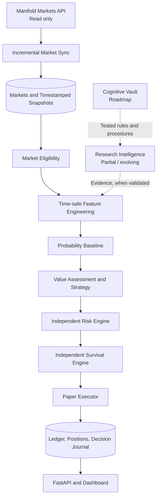
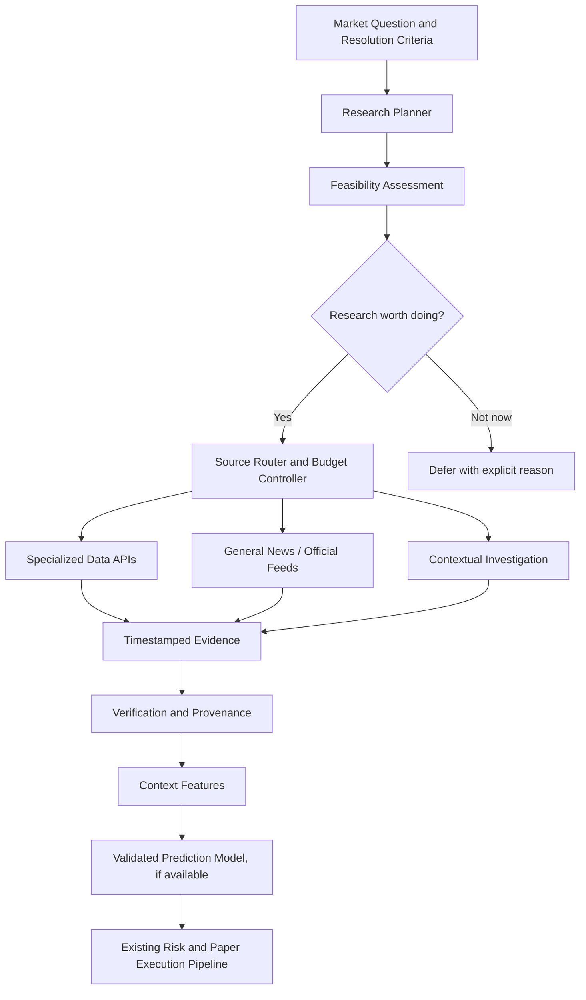
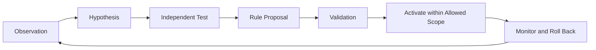

<div align="center">

# AMBRE

### Adaptive Market Betting & Reasoning Engine

**An experimental prediction-market research engine that observes, reasons, estimates, and learns — without risking real money.**

*Market intelligence · Probabilistic reasoning · Paper execution · Adaptive research · Auditable decisions*

[Quick Start](#quick-start) · [How It Works](#how-ambre-works) · [Architecture](#architecture) · [Current Status](#current-status) · [Roadmap](#roadmap) · [Safety](#safety-and-limitations)

</div>

---

> [!IMPORTANT]
> **AMBRE is a research project, not a trading product.** The default and currently supported execution mode is **PAPER**, with a local virtual portfolio initialized to **1,000 Mana**. AMBRE v0.1 does **not** place orders on Manifold Markets, use real money, or establish that any strategy is profitable. Advanced intelligence features described below are a roadmap unless explicitly labeled implemented.

## What is AMBRE?

AMBRE (*Adaptive Market Betting & Reasoning Engine*) is a modular framework for studying prediction markets on [Manifold Markets](https://manifold.markets). It connects market observation to probability estimation, value assessment, independent risk and survival controls, simulated execution, and full decision logging.

The long-term goal is broader than finding apparently mispriced markets. AMBRE is designed to become an **evidence-driven research system**: one that can identify what it does not know, decide which information is worth collecting, track how evidence changes predictions, and experimentally improve its own research procedures.

AMBRE is built around a simple distinction:

- **Research** answers: *What information is available, missing, current, and relevant?*
- **Prediction** answers: *What is the estimated probability of the event?*
- **Value assessment** answers: *Does that estimate differ meaningfully from the market price after costs and impact?*
- **Risk and survival** answer: *Is a simulated position permissible under hard constraints?*
- **Learning** answers: *Did the information and decision process improve results on unseen outcomes?*

These are separate responsibilities. A news article is not a probability, a probability is not a trade, and a simulated return is not proof of a deployable edge.

## Quick Start

### Requirements

- Python **3.12**
- [`uv`](https://docs.astral.sh/uv/)
- Node.js and npm for the optional dashboard
- SQLite is the default database; PostgreSQL support is planned/configurable but was not validated on the development machine described in the v0.1 project context.

```bash
# Install Python dependencies
uv sync

# Initialize the database
uv run ambre init-db

# Read a small set of public Manifold markets
uv run ambre sync --max-pages 2

# Run one decision cycle (PAPER mode)
uv run ambre cycle

# Or run the existing decision worker
uv run ambre worker --interval 300

# Start the read-oriented API
uv run uvicorn ambre.api.app:app --port 8000

# Run the test suite
uv run pytest -q
```

Optional dashboard:

```bash
cd apps/dashboard
npm install
npm run dev
```

- Dashboard: `http://localhost:3000`
- API: `http://localhost:8000`

> [!NOTE]
> The commands above are documented for the v0.1 foundation. Research-module commands and scheduling behavior depend on which later features are present in your checkout. Inspect `uv run ambre --help` and the latest `REPRISE.md` before assuming a command exists.

## How AMBRE Works



**1. Observe.** AMBRE reads public Manifold markets through a read-only integration. Incremental synchronization tracks its progress with a watermark and recovery cursor, avoiding unnecessary reprocessing.

**2. Filter.** The initial eligibility logic focuses on supported binary `cpmm-1` markets and checks constraints such as liquidity, participation, and closing time.

**3. Estimate.** Baseline estimators such as `MarketPriceBaseline` and `BaseRateShrinkage` provide initial probability estimates. These are **not yet validated forecasting models**.

**4. Evaluate.** The `VALUE_HUNTER` strategy compares estimated probabilities with market prices, evaluates expected value and CPMM impact, and considers penalized fractional Kelly sizing.

**5. Protect.** Risk and survival engines independently constrain actions. Invalid or non-finite values are rejected. An operating state such as `HALTED` prevents actions even if a strategy proposes them.

**6. Simulate.** The paper executor records hypothetical positions using an idempotent ledger. No real Manifold order is submitted.

**7. Explain.** Decisions, rejections, states, and simulated outcomes are recorded for inspection and future evaluation.

## Core Architecture

AMBRE uses a **modular Python monolith**. Quantitative business logic is kept pure: it does not perform network requests or direct database access.

| Module | Responsibility | v0.1 status |
|---|---|---|
| `config/` | Safe configuration defaults; `.env` and YAML configuration | Implemented |
| `domain/` | Shared Pydantic contracts and enumerations | Implemented |
| `integrations/manifold/` | Read-only API client, retries, backoff, JSON normalization | Implemented |
| `infrastructure/` | SQLAlchemy persistence and Alembic migrations | Implemented |
| `data_engine/` | Incremental synchronization, recovery, deduplication | Implemented |
| `feature_engine/` | Timestamp-aware features | Implemented |
| `prediction_engine/` | Initial market-price and base-rate baselines | Implemented; not validated |
| `value_engine/` | CPMM calculations, eligibility, expected value, Kelly | Implemented with known simulation limits |
| `strategy_engine/` | `ValueHunter` and `NoTrade` | Implemented |
| `risk_engine/` | Bet/exposure caps, edge checks, finite-number validation | Implemented |
| `survival_engine/` | Portfolio-state safeguards and terminal stop conditions | Implemented |
| `portfolio/` | Ledger, positions, valuation, resolution settlement | Implemented |
| `execution_engine/` | Atomic paper execution and execution-mode guard | Implemented |
| `pipeline.py` | One complete decision cycle | Implemented |
| `cli.py` | Initialization, sync, cycles, worker, simulation controls | Implemented |
| `api/` | Read API and emergency halt/resume | Implemented |
| `apps/dashboard/` | Next.js application | v0.1 dashboard exists; research views not yet implemented |

### Example project layout

```text
ambre/
├── configs/
│   └── default.yaml
├── docs/
│   └── superpowers/
│       ├── specs/
│       └── plans/
├── src/
│   └── ambre/
│       ├── api/
│       ├── config/
│       ├── data_engine/
│       ├── domain/
│       ├── execution_engine/
│       ├── feature_engine/
│       ├── infrastructure/
│       ├── integrations/
│       │   └── manifold/
│       ├── portfolio/
│       ├── prediction_engine/
│       ├── risk_engine/
│       ├── strategy_engine/
│       ├── survival_engine/
│       ├── value_engine/
│       ├── cli.py
│       └── pipeline.py
├── apps/
│   └── dashboard/
├── REPRISE.md
└── README.md
```

This tree illustrates the **v0.1 foundation**, not every file or any later research extension. Use the checked-out source as the source of truth.

## Risk and Survival: Two Independent Gates

AMBRE deliberately separates **position-level risk** from **portfolio-level survival**.

### Initial experimental risk parameters

| Parameter | Default |
|---|---:|
| Maximum simulated bet | 2% of portfolio value |
| Maximum total exposure | 20% of portfolio value |
| Kelly multiplier | 0.25 |
| Minimum edge after market impact | 3% |
| Starting paper balance | 1,000 Mana |

These are experimental settings, **not optimized or validated trading parameters**.

### Survival-state precedence

Rules are evaluated in order; the first matching rule wins.

| Priority | Condition | State / action |
|---:|---|---|
| 1 | Manual emergency stop | `HALTED` |
| 2 | Exposure cannot be determined | `OBSERVING` |
| 3 | Portfolio valuation invalid | `HALTED` |
| 4 | Value ≤ 50% of initial capital | `HALTED`; simulation permanently dead |
| 5 | Relevant data older than 15 minutes | `OBSERVING` |
| 6 | Drawdown ≥ 30% | `CRITICAL` |
| 7 | Drawdown ≥ 15% | `DEFENSIVE`; stake multiplier 0.5 |
| 8 | Otherwise | `BALANCED` |

A dead simulation is **never resurrected** by resetting its balance. A new simulation must be created; the previous one remains archived.

Invariants include:

- Missing values are `null` / `None`, **never silently replaced with `0`**.
- `NaN`, infinity, or malformed financial quantities cannot bypass risk checks.
- An interrupted or skipped market evaluation is not falsely recorded as a completed evaluation.
- A research result cannot authorize execution; risk, survival, and execution guards remain authoritative.

## Research Intelligence: Current Capabilities and Gaps

AMBRE is being extended beyond market-only data toward **market-driven external research**. This work is **partial**, not a fully autonomous intelligence agent.

Based on the latest implementation report shared for this project:

- **USGS is the only active, operational research connector** in the reported research subsystem.
- **Open-Meteo has a working connector**, but its research path was not activated by matching real open markets in the observed sample.
- **Seven other whitelisted providers are registered but disabled**.
- The research planner currently handles **earthquake-related questions** with limited, hard-coded geographic coverage.
- Candidate links between research events and markets **do not yet modify probability estimates**.
- `ambre research` has been run manually; a robust recurring research scheduler is still a target feature.
- Research-source contribution scoring, ranking, and contextual-bandit learning are **not implemented**.
- A dedicated research dashboard is **not implemented**.

### A coverage bottleneck, not a polling failure

In one reported snapshot of **1,143 open markets**, **2** were research-collectable under the available planner and connector constraints; **1,093** were classified but lacked a usable provider. The remaining **48** were not accounted for in that summary and require audit.

The two earthquake markets could share one USGS request. Ten-minute caching and planning intervals therefore reduced calls by design. **Low call count was not, by itself, a defect. Low domain coverage was the principal limitation.**

This snapshot is diagnostic, not a live statistic or a benchmark of the current Git checkout.

### Planned: Universal Research Engine

The intended system starts with the **market's information needs**, not a fixed list of enabled APIs:



The goal is to cover relevant research questions in weather, economics, finance, technology, sports, geopolitics, science, public health, and other domains **without pretending every domain can be predicted accurately**.

### Planned: Feasibility before research

AMBRE should distinguish at least four independent concepts:

| Signal | Question it answers |
|---|---|
| `research_feasibility` | Can accessible sources provide useful evidence? |
| `prediction_feasibility` | Is there sufficient data and a validated model to make a defensible estimate? |
| `p_yes` | What is the estimated probability of a YES resolution? |
| `expected_information_value` | Is additional research likely to improve the decision enough to justify its cost? |

**These are not interchangeable.** It may be easy to retrieve earthquake records but impossible to make a calibrated short-term prediction of a major earthquake. Early feasibility assessments should use explicit statuses such as `HIGH`, `MEDIUM`, `LOW`, or `UNKNOWN` until numerical probabilities can be calibrated against real outcomes.

The value-of-information decision is conceptually:

```text
Expected value of information
  = expected best decision utility after research
  - best decision utility using current information
  - research cost
```

This is an objective for future measurement, **not a currently validated scoring formula**.

### Candidate data-source domains

| Domain | Examples of candidate providers | Note |
|---|---|---|
| Global news | GDELT, Marketaux, GNews, NewsData.io | Licensing, delays, and quotas differ |
| Financial / macro | FRED, ECB, Eurostat, SEC EDGAR | Prefer official primary releases |
| Social signals | Bluesky, Hacker News, Reddit, YouTube | Popularity does not establish truth |
| Sports | football-data.org, TheSportsDB, OpenF1 | Coverage and live access vary |
| Weather | Open-Meteo, NOAA, MET Norway | Historic forecast availability matters |
| Geopolitics / disasters | ReliefWeb, GDELT, NASA EONET, USGS | Early reports may be revised |
| Science / technology | arXiv, OpenAlex, GitHub, Crossref | Publication is not proof of outcome |

**Listing a provider does not mean it is implemented, enabled, free for all uses, or approved for production.** Each connector requires a verified API contract, licensing review, quotas, provenance, and isolated tests.

## Cognitive Vault: The Long-Term Knowledge Layer

**Cognitive Vault is a proposed capability, not part of the documented v0.1 foundation.**

Inspired by linked-note systems, the Cognitive Vault would let AMBRE maintain traceable knowledge and reusable procedures. It is intended to improve the **research process**, not grant an agent uncontrolled authority over its source code.

Planned knowledge objects include:

- **Observations:** what an external provider actually returned.
- **Claims:** assertions made by identifiable sources.
- **Facts:** claims verified under explicit evidence rules.
- **Hypotheses:** candidate explanations awaiting tests.
- **Experiences:** past research and decision outcomes.
- **Lessons:** reusable findings from reviewed outcomes.
- **Rules:** bounded decision or research policies.
- **Shortcuts:** declarative sequences of preapproved operations.



A rule would move through auditable states such as `DRAFT`, `PROPOSED`, `TESTING`, `VALIDATED`, `ACTIVE`, `DEPRECATED`, or `ROLLED_BACK`.

**Self-improvement is constrained:** AMBRE may propose more conservative limits, source preferences, or a safe shortcut. It may **not** remove risk caps, weaken hard safeguards, create paid subscriptions, execute arbitrary generated code, alter secrets, or enable real-money trading.

## Adaptive Scheduling: Planned

The existing decision worker supports regular execution. A dedicated **research scheduler** is a separate planned component.

It should coordinate:

- Periodic jobs based on source freshness and release schedules.
- Event-driven refreshes for markets affected by new evidence.
- Shared, deduplicated requests across related markets.
- Persistent jobs and restart recovery.
- Per-provider rate limits and reserved capacity for high-priority queries.
- Deferred statuses when quotas, outages, or safety controls prevent work.

**More API calls are not the goal.** A successful scheduler increases useful evidence coverage while minimizing duplicate and stale requests.

## Learning and Evaluation: Planned

AMBRE is not yet a continuously learning system. Future development will measure whether research actually improves out-of-sample predictions rather than simply making explanations more elaborate.

Proposed evaluation layers:

1. **Backtesting:** reconstruct what was knowable at each historical decision time.
2. **Forecast quality:** measure calibration, Brier score, and log loss.
3. **Source contribution:** compare models with and without specific source groups.
4. **Decision quality:** measure paper returns, drawdown, and cost under realistic execution assumptions.
5. **Research efficiency:** measure useful evidence per request, latency, and compute/token cost.
6. **Policy learning:** adopt adaptive selection or contextual bandits only after reliable logged outcomes exist.

Every external observation should preserve distinct timestamps for **event time**, **publication time**, **actual availability time**, and **ingestion/observation time**. A later article or corrected dataset must never be injected into an earlier simulated decision.

## Current Status

| Capability | Status |
|---|---|
| Read-only Manifold market ingestion | **Implemented (v0.1)** |
| Incremental synchronization and timestamped snapshots | **Implemented (v0.1)** |
| Binary CPMM eligibility, value calculations, baseline estimators | **Implemented, experimental** |
| Independent risk and survival gates | **Implemented (v0.1)** |
| Paper execution and persistent decision journal | **Implemented (v0.1)** |
| Read API and initial dashboard app | **Implemented (v0.1)** |
| USGS research connector | **Reported operational in later research work** |
| Open-Meteo connector | **Reported functional; no matching market in sample** |
| Generic cross-domain research planner | **Not implemented** |
| Research evidence → validated probability model | **Not implemented** |
| Dedicated autonomous research scheduler | **Not implemented** |
| Broad API connector coverage | **Not implemented** |
| Historical backtesting framework | **Not implemented** |
| Selective participant imitation | **Not implemented** |
| AI contextual reasoning integration | **Not implemented** |
| Continuous learning and source ranking | **Not implemented** |
| Cognitive Vault and self-generated rule validation | **Proposed** |
| Real Mana order placement | **Disabled / unsupported in v0.1** |
| Real-money execution | **Out of scope** |

This table reflects the shared project status, **not an independent audit of the repository**. Check `REPRISE.md`, the source tree, and test output for the latest verified state.

## Roadmap

### Phase 1 — Foundation (**v0.1; implemented**)

- [x] Read-only Manifold integration
- [x] Incremental market synchronization
- [x] Pure quantitative modules
- [x] PAPER execution and ledger
- [x] Risk limits and survival states
- [x] CLI, FastAPI, and dashboard foundation
- [x] Offline testing infrastructure

### Phase 2 — Research Coverage (**partially underway**)

- [x] First operational USGS research path (reported)
- [x] Open-Meteo connector (reported functional)
- [ ] Audit unexplained market-classification totals
- [ ] Parse full market resolution criteria
- [ ] General-purpose research planning
- [ ] Multi-domain source adapters
- [ ] Evidence provenance, contradictions, and temporal validation
- [ ] Research-to-feature bridge with explicit model support
- [ ] Periodic/event-driven research scheduling

### Phase 3 — Evaluation

- [ ] Reproducible chronological backtesting
- [ ] Calibration and forecast-scoring reports
- [ ] Source and research-policy ablations
- [ ] Realistic CPMM and order-book execution assumptions
- [ ] Clear estimates of research costs and marginal information value

### Phase 4 — Cognitive Intelligence

- [ ] Linked, versioned knowledge base
- [ ] Learned-rule proposals and conflict checks
- [ ] Safe declarative shortcuts
- [ ] Sandbox evaluation, promotion, and rollback
- [ ] Adaptive source ranking and research-policy experiments

### Phase 5 — Advanced Learning

- [ ] Selective observation of successful forecasters
- [ ] Contextual model-assisted extraction and research planning
- [ ] Continuous learning from resolved outcomes with strict chronological validation
- [ ] Contextual bandits only where supported by measured evidence

Roadmap items are **intentions, not promises or shipped functionality**.

## Technology Stack

| Layer | Technology |
|---|---|
| Core language | Python 3.12 |
| Dependency and environment management | uv |
| HTTP API | FastAPI |
| Data contracts | Pydantic v2 |
| HTTP client | HTTPX |
| Database access and migrations | SQLAlchemy 2, Alembic |
| Default database | SQLite |
| Planned database deployment | PostgreSQL / Docker Compose |
| Tests and properties | pytest, Hypothesis |
| Lint and static typing | Ruff, mypy strict |
| Frontend | Next.js, strict TypeScript |
| UI | Tailwind CSS, shadcn/ui |
| Data fetching / visualization | TanStack Query, Recharts |

External LLM integrations (such as OpenAI, Gemini, Qwen, Kimi, or local models) are **future options**, not required dependencies of the v0.1 quantitative pipeline.

## Testing and Reproducibility

```bash
uv run pytest -q
```

The v0.1 project context reported **260 tests**. That count is a historical project claim, not a guaranteed count for every commit.

Testing principles:

- Unit tests do **not** make live network requests.
- Real Manifold response samples may be kept as recorded fixtures.
- Hand-authored test fixtures must be clearly marked `synthetic_`.
- Forecast and backtest datasets must preserve availability-time boundaries.
- Critical portfolio invariants are covered by regression and property tests.
- Optional live integration checks should be explicit, isolated, and never used to conceal failing offline tests.

## Safety and Limitations

> [!WARNING]
> **Prediction markets are uncertain by definition.** AMBRE's estimates, scores, and paper outcomes should not be interpreted as investment advice, proof of predictive skill, or evidence of real-world profitability.

Known limitations of the documented foundation and research extension:

- Baseline probability estimates have not been validated on a meaningful held-out historical benchmark.
- CPMM simulation is partial and does not fully account for limit-order-book behavior.
- No comprehensive historical backtesting engine is available yet.
- PostgreSQL was not exercised on the originally described development machine.
- Market ingestion uses polling rather than WebSocket streaming.
- Research coverage is narrow and source connectors are mostly not enabled.
- Event-to-market associations are candidates until resolution criteria and evidence have been validated.
- Research results do not yet feed a validated cross-domain prediction model.
- No reliable source-ranking or self-learning claims can be made at this stage.

Safety boundaries:

1. **PAPER by default:** no real-money transactions, and no live Mana orders in v0.1.
2. **Independent guards:** external research and LLM output cannot bypass risk/survival checks.
3. **Temporal honesty:** use only information available at the simulated decision time.
4. **Explicit uncertainty:** unknown values remain unknown; missing data is not zero.
5. **Auditability:** preserve source provenance, decision traces, and irreversible simulation histories.
6. **Authorized collection:** respect third-party licenses, access policies, authentication, and rate limits.
7. **No arbitrary self-modification:** proposed rules and shortcuts require validation and bounded execution.

## Project Documentation

For implementation details, consult the files already maintained in the repository:

- [`REPRISE.md`](REPRISE.md) — development progress and current implementation notes.
- [`docs/superpowers/specs/2026-10-31-ambre-master-spec.md`](docs/superpowers/specs/2026-10-31-ambre-master-spec.md) — master specification.
- [`docs/superpowers/plans/2026-10-31-ambre-v0.1-foundation.md`](docs/superpowers/plans/2026-10-31-ambre-v0.1-foundation.md) — v0.1 implementation plan.

Those documents and the checked-out code take precedence over aspirational descriptions in this README.

## License and Contributions

**License:** No license is declared here because the repository's actual licensing choice was not provided. Add a `LICENSE` file and update this section before presenting the project as open-source under a specific license.

Contributions should preserve the project's safety invariants, avoid unnecessary architecture changes, include offline tests, and document the difference between implemented behavior and future designs.

---

<div align="center">

**AMBRE is an experiment in disciplined machine research:**

*Know what is known. Measure what is uncertain. Research what matters. Test what improves decisions.*

</div>
